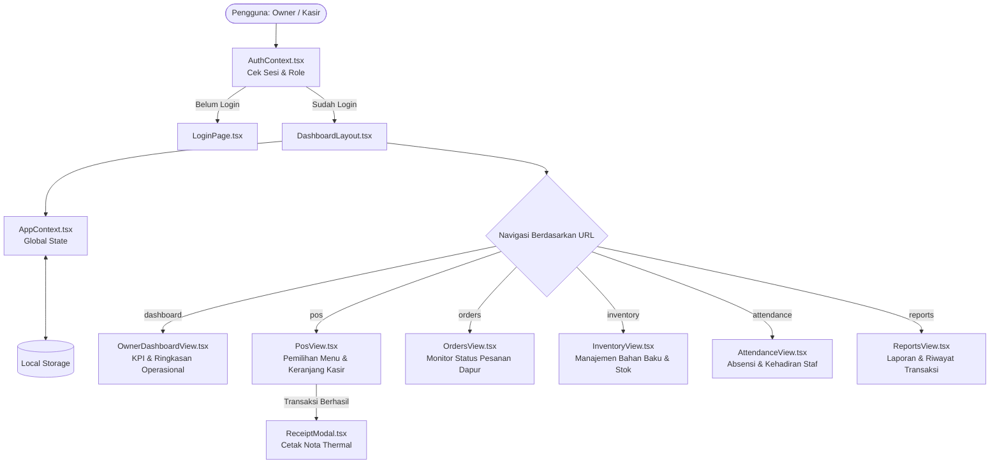

# ☕ Dashboard Warkop Wong Kito

Sistem Manajemen Operasional & Kasir POS (*Point of Sale*) modern berbasis web untuk **Warkop Wong Kito**. Sistem ini mengintegrasikan fungsi kasir cepat, antrean pesanan dapur, manajemen stok inventaris, absensi tim, hingga pelaporan transaksi dan cetak nota belanja.

---

## 🚀 Teknologi Utama (Tech Stack)

* **Framework:** [Next.js](https://nextjs.org) 16 (App Router) & [React](https://react.dev) 19
* **Bahasa:** [TypeScript](https://www.typescriptlang.org)
* **Styling:** [Tailwind CSS](https://tailwindcss.com) v4
* **Ikonografi & Visual:** [Lucide React](https://lucide.dev), [Recharts](https://recharts.org), [Canvas Confetti](https://www.npmjs.com/package/canvas-confetti)
* **State Management:** React Context API (`AuthContext` & `AppContext`) dengan persistensi lokal (`localStorage`)
* **Audio Engine:** Web Audio API (Synthesizer efek suara tanpa aset eksternal)

---

## 📁 Struktur Direktori & Arsitektur Kode

```text
dashboard-wongkito/
├── public/                     # Aset statis dan logo aplikasi
├── src/
│   ├── app/                    # Next.js App Router root
│   │   ├── layout.tsx          # Root layout, penyedia Auth & App Provider, font
│   │   ├── page.tsx            # Redirect ke /dashboard (sudah login) atau /login
│   │   ├── globals.css         # Konfigurasi Tailwind CSS, font, & styling cetak struk (@media print)
│   │   ├── api/                # Route handler backend (auth & manajemen akun)
│   │   ├── (auth)/login/       # Halaman /login (+ _components/LoginPage.tsx)
│   │   ├── (dashboard)/        # Semua halaman setelah login, tiap fitur punya URL sendiri
│   │   │   ├── layout.tsx      # Guard login & role, shell DashboardLayout, ReceiptModal
│   │   │   ├── dashboard/      # /dashboard     – ringkasan analitik dan KPI operasional
│   │   │   ├── pos/            # /pos           – interface transaksi kasir (Point of Sale)
│   │   │   ├── orders/         # /orders        – monitor pesanan aktif dan alur dapur
│   │   │   ├── menu/           # /menu          – CRUD katalog produk (Owner)
│   │   │   ├── inventory/      # /inventory     – bahan baku dan peringatan stok menipis
│   │   │   ├── reports/        # /reports       – rekap penjualan dan laporan pendapatan
│   │   │   ├── attendance/     # /attendance    – absensi dan kehadiran staf
│   │   │   ├── team/           # /team          – manajemen akun kasir (Owner)
│   │   │   ├── notifications/  # /notifications – notifikasi pesanan & stok
│   │   │   ├── profile/        # /profile       – profil akun dan ganti password
│   │   │   └── settings/       # /settings      – konfigurasi outlet (Owner)
│   │   │                       #   (tiap folder: page.tsx + _components/<View>.tsx)
│   │   ├── _components/        # Komponen bersama (private folder, tidak jadi route)
│   │   │   ├── common/         # ReceiptModal untuk nota belanja
│   │   │   └── layout/         # Shell navigasi (Sidebar responsif, Header, Topbar, Search)
│   │   ├── _context/           # Global State Management
│   │   │   ├── AppContext.tsx  # State bisnis (menu, pesanan, keranjang POS, stok, setting)
│   │   │   └── AuthContext.tsx # State autentikasi sesi pengguna (Owner / Kasir)
│   │   ├── _data/
│   │   │   └── mockData.ts     # Data awal (katalog menu, pesanan awal, stok)
│   │   └── _utils/
│   │       └── format.ts       # Format mata uang Rupiah, waktu lokal, dan Web Audio chime
│   ├── lib/                    # Helper bersama client & server (akses role, aturan password)
│   ├── server/                 # Logika backend (database, sesi, rate limit, hashing)
│   └── types/
│       └── index.ts            # Kontrak tipe dan interface TypeScript
├── package.json
└── tsconfig.json
```

---

## 🔄 Alur Kerja Aplikasi (Workflow & Architecture Flow)



### 1. Autentikasi & Multi-Role (`AuthContext.tsx`)
- Mendukung 2 role pengguna:
  - **`superadmin` (Owner):** Akses penuh ke seluruh menu (Dashboard KPI, Laporan Keuangan, Team, Stok, dll).
  - **`kasir` (Staff Kasir):** Fokus ke fungsi harian kasir (POS Kasir, Pesanan Dapur, Cek Stok, Absensi).
- Sesi login disimpan di server (PostgreSQL); browser hanya memegang cookie httpOnly. *Ingat saya* membuat cookie bertahan setelah browser ditutup.

### 2. Navigasi Berbasis URL (`src/app/(dashboard)/`)
- Tiap fitur punya halaman sendiri (`/pos`, `/orders`, `/team`, ...), jadi bisa di-bookmark dan tombol back browser berfungsi.
- `activeTab` di `AppContext` dibaca dari URL; `setActiveTab('pos')` sama dengan pindah ke `/pos`.
- `(dashboard)/layout.tsx` mengarahkan pengguna yang belum login ke `/login`, dan role yang tidak berhak (misalnya kasir membuka `/team`) ke `/dashboard`.

### 3. POS Kasir & Cetak Struk (`PosView.tsx` & `ReceiptModal.tsx`)
- Pemilihan menu instan dengan filter kategori (*Kopi, Non-Kopi, Makanan, Cemilan, Signature*).
- Kalkulasi otomatis subtotal, diskon promo, dan pajak PB1 (10%).
- Saat transaksi selesai melalui `createOrder()`, stok otomatis berkurang, efek suara berhasil dipicu, dan `ReceiptModal` muncul siap dicetak ke printer kasir.

---

## 🧩 Analisis Modul & Fungsi-Fungsi Kunci

### 1. Global State Management (`src/app/_context/AppContext.tsx`)
Menangani logika operasional utama:
* `addToCart(item, notes)`: Memasukkan item menu ke keranjang belanja POS, memperbarui kuantitas jika sudah ada, serta memicu efek suara klik (`playChime`).
* `updateCartQuantity(itemId, delta)`: Menambah atau mengurangi kuantitas item dalam keranjang (otomatis menghapus jika kuantitas mencapai 0).
* `createOrder(orderData)`: Membuat data pesanan baru dengan nomor nota otomatis (format: `WK-YYYYMMDD-XXX`), memotong stok bahan baku terkait, dan menetapkan `lastCompletedOrder`.
* `updateOrderStatus(orderId, newStatus)`: Mengubah alur status pesanan (`pending` $\rightarrow$ `processing` $\rightarrow$ `ready` $\rightarrow$ `completed` $\rightarrow$ `cancelled`).
* `restockItem(id, addedStock, totalCost)`: Menambahkan jumlah stok fisik inventaris dan memperbarui riwayat tanggal restock.
* `toggleMenuAvailability(id)`: Mengaktifkan atau menonaktifkan status ketersediaan item menu secara langsung.

### 2. Autentikasi Pengguna (`src/app/_context/AuthContext.tsx`)
* `login(email, password, rememberMe)`: Memvalidasi kredensial pengguna dan menginisialisasi sesi.
* `demoLogin(role)`: Fasilitas login cepat 1-klik untuk testing mode Owner (`superadmin`) atau Kasir (`kasir`).
* `logout()`: Menghapus sesi aktif dari state dan penyimpanan lokal.

### 3. Komponen Nota Kasir (`src/app/_components/common/ReceiptModal.tsx`)
* Menampilkan antarmuka struk bergaya printer thermal 58mm/80mm (`#thermal-receipt`).
* Memuat rincian toko (nama, alamat, no. telepon dari `settings`), detail nomor nota, kasir bertugas, meja/tipe pesanan, rincian menu beserta catatan, subtotal, diskon, pajak, nominal tunai, dan kembalian.
* Fungsi `handlePrint()` memanggil `window.print()` yang dipadukan dengan style `@media print` sehingga yang tercetak di kertas hanyalah kertas struk tanpa elemen dashboard lainnya.

### 4. Format & Web Audio Helper (`src/app/_utils/format.ts`)
* `formatRupiah(amount)`: Memformat angka ke format standar mata uang Rupiah Indonesia (contoh: `Rp 18.000`).
* `formatDateTime(dateString)` & `formatTimeOnly(dateString)`: Mengonversi format ISO ke format penanggalan lokal Indonesia (`id-ID`).
* `playChime(type)`: Memanfaatkan Web Audio API peramban untuk menghasilkan efek bunyi audio synthesizer tanpa membutuhkan file `.mp3` eksternal (`success`, `alert`, `click`).

### 5. Kontrak Tipe Data (`src/types/index.ts`)
Mendefinisikan entitas data utama:
* `User`: Informasi pengguna dan hak akses (`superadmin` | `kasir`).
* `MenuItem`: Data produk katalog, kategori, harga jual, HPP (*cost price*), dan stok.
* `Order`: Data lengkap transaksi penjualan, metode bayar, kasir, dan status pesanan.
* `StockItem`: Data kontrol stok bahan baku beserta batas minimum peringatan (*minStock*).
* `StoreSettings`: Konfigurasi toko, tarif PB1, alamat, jam buka, dan footer struk.

---

## 🛠️ Cara Menjalankan Proyek Secara Lokal

1. **Clone repositori dan pasang dependensi:**
   ```bash
   git clone <repository-url>
   cd dashboard-wongkito
   npm install
   ```

2. **Jalankan server pengembangan:**
   ```bash
   npm run dev
   ```

3. **Buka di peramban:**
   Akses [http://localhost:3000](http://localhost:3000)

4. **Build untuk produksi:**
   ```bash
   npm run build
   npm run start
   ```

---

## 🔑 Kredensial Pengujian (Demo Login)

Aplikasi menyediakan tombol cepat **Demo Login** di halaman login:
* **Owner / Superadmin:** `warkopwongkito@gmail.com` (password: `admin123` atau sembarang min 4 karakter)
* **Kasir:** Tersedia tombol *Demo Kasir* langsung pada halaman login.
